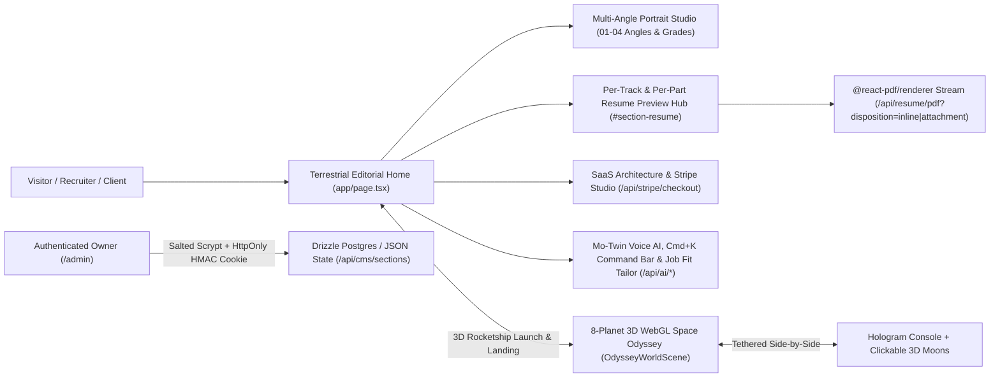

<div align="center">

# Mohamed Datt (`@MeeksonJr`) — 2026–2027 Flagship Spatial AI Portfolio

**Full-Stack AI Engineer & Spatial Web Architect** · B.S. Computer Science @ Old Dominion University (3.8 GPA) · 1st Place / 13 Teams · 2 Commercial SaaS Acquisitions

[](https://nextjs.org/)
[](https://react.dev/)
[](https://www.typescriptlang.org/)
[](https://threejs.org/)
[](https://orm.drizzle.team/)
[](https://stripe.com/)
[](https://ai.google.dev/)

</div>

---

## Overview

A dual-universe interactive flagship portfolio engineered with **Next.js 16 (App Router + Turbopack)**, **React 19**, **Three.js / React Three Fiber**, **Drizzle ORM + PostgreSQL**, **Stripe Checkout**, **@react-pdf/renderer**, and **Google Gemini AI (`@google/genai`)**.

Designed to pass both the **6-second technical recruiter scan** and showcase deep systems engineering:

- **Universe 1 — Dribbble Editorial Terrestrial Home:** Expressive `Syne` + `Instrument Serif` + `JetBrains Mono` typography, an interactive **Multi-Angle Portrait Studio** (`01 Studio Noir`, `02 Arch Orbital`, `03 Field Stance`, `04 Builder Mode` + `Noir` / `Amber` / `Natural` color grades), a Sticky Creator ID Bento, a full-width Selected Work Vault, an **On-Page Multi-Track & Per-Part Resume Preview Hub**, an **ODU R1 Edge-AI 10Hz Telemetry Lab**, and a **Live Stripe Studio**.
- **3D Rocketship Transition Bridge:** Interactive WebGL Three.js Rocketship takeoff (`launchToSpace`) and landing (`landOnEarth`) bridge connecting the Terrestrial Home with the 3D star system.
- **Universe 2 — 8-Planet 3D Interplanetary Space Odyssey:** Orbit and warp camera coordinates across 8 celestial stations (*Prime Monolith*, *Origin World*, *Launch Vault*, *Synapse Lab*, *Arsenal Ring*, *Commerce Forge*, *Echo Constellation*, *Relay Beacon*) with clickable 3D moons docked alongside a glass Hologram Console.

---

## Architecture & Dual-Universe Flow



---

## Key Engineering Highlights

### 1. Per-Track & Per-Part ResumeForge Engine
- **5 Visitor Role Tracks:** `Master 2026–2027`, `Recruiter / SWE`, `Systems & 3D`, `ODU Edge-AI Lab`, and `SaaS Founder` (`lib/resume/resume-presets.ts`).
- **Per-Part Section Filtering:** Visitors can inspect the full 1-page resume sheet or isolate **Part 01 (Executive Summary)**, **Part 02 (Technical Stack)**, **Part 03 (Experience & R1 Research)**, **Part 04 (Selected Projects & Acquisitions)**, and **Part 05 (Education & 3.8 GPA Honors)**.
- **Dual View Modes:** Instant plain-text ATS sheet with 1-click clipboard export (`Copy ATS Text`), or inline live PDF rendering (`Live PDF Frame`) powered by `/api/resume/pdf`.
- **Gemini AI Job Tailor:** Paste any Job Description to compute fit scores, matched projects, and custom PDF overrides (`POST /api/ai/tailor-resume`).

### 2. Live Stripe Studio & Scope Estimator
- Real **Stripe Checkout** integration (`lib/stripe.ts`, `/api/stripe/checkout`) supporting both hosted `buy.stripe.com` Payment Links (with prefilled customer email) and dynamic itemized Checkout Sessions (`stripe.checkout.sessions.create` when `STRIPE_SECRET_KEY` is present).
- Interactive tier selection (`Quick Fix & Audit`, `Spatial Landing / Brand`, `Full AI SaaS Platform`) with live module add-ons.

### 3. Security-First Architecture
- **Salted `scrypt` Admin Vault (`/admin`):** Zero plaintext credentials in source or build artifacts; constant-time digest verification (`crypto.timingSafeEqual`) paired with `httpOnly`, HMAC-SHA256 signed session cookies (`lib/auth/admin-auth.ts`).
- **Sliding-Window Rate Limiting (`lib/security/rate-limit.ts`):** Throttles `POST /api/admin/auth` (5 attempts / 15 min per IP -> `HTTP 429`), `/api/ai/*`, `/api/guestbook`, and `/api/resume/pdf`.
- **Authenticated Admin Boundaries:** `PUT/DELETE /api/cms/sections`, `POST /api/admin/upload`, and `POST /api/ai/rewrite` strictly require verified admin cookies (`HTTP 401`).
- **Binary Upload Validation:** Restricts admin uploads to raster formats (`.png`, `.jpg`, `.jpeg`, `.webp`, `.gif`) and checks binary magic bytes before writing files.
- **HTTP Security Headers & Input Sanitization:** Configured `X-Content-Type-Options: nosniff`, `X-Frame-Options: SAMEORIGIN`, `Referrer-Policy: strict-origin-when-cross-origin`, `Permissions-Policy`, Zod schema validation, and HTML tag stripping.

### 4. SEO, GEO & WCAG 2.2 AA Accessibility
- Built-in `app/robots.ts` (`/robots.txt`), `app/sitemap.ts` (`/sitemap.xml`), dynamic App Router icon & OpenGraph generators (`app/icon.tsx`, `app/opengraph-image.tsx`), and a Schema.org `@graph` JSON-LD payload (`Person`, `ProfilePage`, `WebSite`, `SoftwareApplication`) in `app/layout.tsx`.
- Accessible `Skip to main content` link, `:focus-visible` high-contrast indicators, explicit form `aria-label` attributes, and keyboard-escapable `role="dialog"` modals.

---

## Project Structure

```text
app/
├── admin/                  # Protected /admin vault dashboard (sections, planets, media, AI copy)
├── api/
│   ├── admin/auth/         # Salted scrypt auth + sliding-window IP lockout
│   ├── admin/upload/       # Authenticated raster upload with magic-byte verification
│   ├── ai/agent/           # Gemini Mo-Twin conversational navigation agent
│   ├── ai/rewrite/         # Admin-authenticated copy rewriter
│   ├── ai/tailor-resume/   # AI job-description fit analyzer
│   ├── cms/sections/       # Drizzle PostgreSQL / JSON CMS persistence
│   ├── github/             # Live @MeeksonJr GitHub telemetry API
│   ├── guestbook/          # Sanitized & rate-limited visitor guestbook
│   ├── resume/pdf/         # @react-pdf/renderer dynamic PDF endpoint (inline & attachment)
│   └── stripe/checkout/    # Stripe Checkout Session + hosted Payment Link router
├── layout.tsx              # Fonts (Syne, Instrument Serif, Plus Jakarta Sans, JetBrains Mono) + JSON-LD
├── page.tsx                # Server-rendered portfolio snapshot entry
├── robots.ts               # Search engine crawler policy
└── sitemap.ts              # Canonical URL sitemap
components/
├── home/                   # TerrestrialHome & Multi-Angle EditorialPortraitStudio
├── resume/                 # InteractiveResumePreviewSection & ResumePdfDocument
├── three/                  # OdysseyWorldScene, RocketTransitionScene & canvases
├── sections/               # Story, Projects, ODU Research Lab, Stack/GitHub, Stripe Studio, Guestbook, Contact
├── ai/                     # VoiceConcierge, AgenticCommandBar, ResumeTailorModal
└── admin/                  # AdminDashboard (planets, projects, media gallery, CMS editor)
lib/
├── auth/                   # Scrypt verification & HMAC session signing
├── content/                # Portfolio types, 8-planet coordinates & default snapshot
├── db/                     # Drizzle PostgreSQL schema & persistence adapter
├── resume/                 # 5-track persona resume preset generator
├── security/               # Rate limiting & HTML tag sanitizer
└── stripe.ts               # Stripe client & verified hosted checkout mappings
```

---

## Local Development

```bash
# 1. Install dependencies
npm install

# 2. Configure optional environment variables
cp .env.example .env.local

# 3. Start development server
npm run dev
```

### Optional Environment Variables (`.env.local`)
| Variable | Purpose | Fallback if omitted |
| --- | --- | --- |
| `GEMINI_API_KEY` | Live Gemini `gemini-2.5-flash` responses, Voice Twin, AI Tailor & Rewrite | Deterministic local knowledge & matching engine |
| `DATABASE_URL` | PostgreSQL / Neon / Supabase connection string for Drizzle ORM | Local JSON fallback + curated snapshot defaults |
| `ADMIN_SESSION_SECRET` | HMAC-SHA256 secret for `/admin` session cookies | Derived server signing secret |
| `STRIPE_SECRET_KEY` | Dynamic itemized Stripe Checkout Sessions | Routes to verified `buy.stripe.com` hosted checkout links |
| `NEXT_PUBLIC_SITE_URL` | Canonical production base URL (`robots.ts`, `sitemap.ts`, OG tags) | Defaults to `https://meekson.me` |
| `GITHUB_TOKEN` | Higher API rate limit for `@MeeksonJr` repo feed | Public GitHub REST API with cached fallback |

### Available Scripts
- `npm run dev` — Start Next.js Turbopack dev server
- `npm run build` — Run TypeScript & optimized production build
- `npm run start` — Serve production build
- `npm run lint` — Run ESLint checks
- `npm run db:generate` / `npm run db:push` — Manage Drizzle ORM schema migrations

---

## Author

**Mohamed Datt** (`@MeeksonJr`)  
Born in Conakry, Guinea · Raised in NYC · Building in Norfolk, VA (Old Dominion University)  
GitHub: [@MeeksonJr](https://github.com/MeeksonJr) · Email: `d.mohamed1504@gmail.com`
